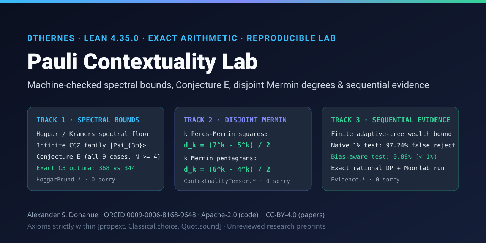

# Pauli Contextuality Lab

Machine-checked Lean 4.35.0 proofs, exact integer/rational verifiers, research preprints, and reproducible interactive labs unifying three Pauli contextuality research tracks: spectral bounds and Jonah's Conjecture E, exact disjoint Mermin configuration degrees, and finite-horizon sequential contextuality certificates.

[](https://github.com/0thernes/pauli-contextuality-lab/actions/workflows/ci.yml)
[](https://github.com/0thernes/pauli-contextuality-lab/actions/workflows/lean-verify.yml)
[](https://0thernes.github.io/pauli-contextuality-lab/)
[](LICENSE)
[](CHANGELOG.md)



**Status:** Active research preprints (`v2.9.0`, 25 November 2026) — **NOT externally peer reviewed**; AI-assisted under human direction ([LIMITATIONS.md](LIMITATIONS.md)).  
**Author:** Alexander S. Donahue, independent researcher ([ORCID 0009-0006-8168-9648](https://orcid.org/0009-0006-8168-9648) · `0_0@0thernes.art`).  
**Live Portal & Blueprint:** [Pauli Contextuality Lab](https://0thernes.github.io/pauli-contextuality-lab/) · [Lean 4 Dependency Blueprint](https://0thernes.github.io/pauli-contextuality-lab/blueprint/) · [Papers](papers/README.md) · [Claims Ledger](CLAIMS.md) · [Statement Fidelity](docs/statement-fidelity.md) · [Errata & Withdrawal](ERRATA.md) · [Mega-Atlas Audit](docs/mega-atlas-cross-reference.md) · [Replication Protocol](REPLICATION.md)

> **Consolidation note:** This repository consolidates four earlier standalone Pauli repositories (`0thernes/hoggar-bound-lab`, `0thernes/hoggar-bound`, `0thernes/contextuality-tensor-lab`, and `0thernes/contextuality-evidence-lab`, all archived read-only with redirects) into one Lean 4.35.0 + Mathlib `v4.35.0` workspace with a single deduplicated `third_party/` stack and open `Apache-2.0` / `CC-BY-4.0` licensing. The zero-Mathlib ray-pool Kochen–Specker repository remains separate at [`0thernes/kochen-specker-extremal-lab`](https://github.com/0thernes/kochen-specker-extremal-lab) to preserve its minimal Mathlib-free trust base.

---

## Five-Second Formal Proof Check (`#print axioms`)

Every theorem across all three Lean 4.35.0 libraries (`HoggarBound`, `ContextualityTensor`, `Evidence`) and the 12-target isolated `Challenge.lean` / `Solution.lean` comparator bridge compiles with **zero `sorry`, zero `admit`, zero `native_decide`, and zero custom axioms**, verified across **6 independent Lean kernels** (`lean-paranoid`, `lean4lean`, `nanoda`, `con-leche`, `con-ron`, `lean-default`) via `lake comparator --paranoid` in CI. Exact verbatim output from `cd lean && lake env lean VerifyAll.lean` ([full 160-declaration + 2,206-theorem exhaustive log](results/lean-axioms-all.log), checked in CI by `scripts/check_readme_axioms.py`):

```text
'HoggarBound.hoggar_bound' depends on axioms: [propext, Classical.choice, Quot.sound]
'HoggarBound.hoggar_bound_quaternionic' depends on axioms: [propext, Classical.choice, Quot.sound]
'HoggarBound.mermin_peres' depends on axioms: [propext, Classical.choice, Quot.sound]
'HoggarBound.degree_three_qubit' depends on axioms: [propext, Classical.choice, Quot.sound]
'HoggarBound.degree_three_qubit_elliptic' depends on axioms: [propext, Classical.choice, Quot.sound]
'HoggarBound.saturation_tfae' depends on axioms: [propext, Classical.choice, Quot.sound]
'HoggarBound.NormPhaseFamily.infinite_nonclosed_saturated_family' depends on axioms: [propext, Classical.choice, Quot.sound]
'HoggarBound.C3ExactOptima.corollary16_exact_binary_optima' depends on axioms: [propext, Classical.choice, Quot.sound]
'HoggarBound.ConjectureE.jonah_conjecture_e_all_nine_cases' depends on axioms: [propext, Classical.choice, Quot.sound]
'HoggarBound.AuditUpgrades.jonah_conjecture_e_all_nine_cases_spectra' depends on axioms: [propext, Classical.choice, Quot.sound]
'HoggarBound.ExactDegreesN4N5.w72_ge_1455' depends on axioms: [propext, Classical.choice, Quot.sound]
'HoggarBound.ExactDegreesN4N5.q9plus_ge_6444' depends on axioms: [propext, Classical.choice, Quot.sound]
'ContextualityTensor.square_minimum_closed_form' depends on axioms: [propext, Classical.choice, Quot.sound]
'ContextualityTensor.pentagram_minimum_closed_form' depends on axioms: [propext, Classical.choice, Quot.sound]
'ContextualityTensor.global_actual_square_minimum' depends on axioms: [propext, Classical.choice, Quot.sound]
'ContextualityTensor.global_actual_pentagram_minimum' depends on axioms: [propext, Classical.choice, Quot.sound]
'Evidence.sharp_minimum' depends on axioms: [propext, Classical.choice, Quot.sound]
'Evidence.BetTree.finite_hitting_bound' depends on axioms: [propext, Classical.choice, Quot.sound]
'Evidence.concrete_classical_false_positive' depends on axioms: [propext, Classical.choice, Quot.sound]
```

---

## Three Unified Research Tracks

| Track | Path & Lean Library | Headline Results | Preprint & Interactive Lab |
|---|---|---|---|
| **1 · Spectral Bounds & Conjecture E** | [`tracks/spectral-bounds/`](tracks/spectral-bounds/README.md) · `lean/HoggarBound/` | Universal & Kramers spectral floors; exact small degrees ($d(Q^+(3,2))=1$, $d(W(5,2))=63$, $d(Q^-(5,2))=9$); infinite pure-CCZ determinant family $|\Psi_{3m}\rangle$ ($m \ge 1$, $N=6$ degree $2{,}016$); $N=4,5$ ladders & unconditional bounds ($1455$, $6444$); **Jonah's Conjecture E** across all 9 vertex cases for all $N \ge 4$; exact four-qubit C3 binary optima (**368 vs 344**, gap 24) via pure-integer MET-SDP certificates. | [Unified PDF](papers/spectral-bounds/unified-contextuality.pdf) · [C3 Lab](https://0thernes.github.io/pauli-contextuality-lab/c3-lab/) · [Explorer](https://0thernes.github.io/pauli-contextuality-lab/independent-review/) |
| **2 · Disjoint Mermin Configurations** | [`tracks/disjoint-mermin/`](tracks/disjoint-mermin/README.md) · `lean/ContextualityTensor/` | Exact closed-form contextuality degrees $d_k = (7^k - 5^k)/2$ ($k$ disjoint Peres–Mermin squares) and $(6^k - 4^k)/2$ ($k$ Mermin pentagrams) with $2d_k/L_k \to 1$, directly answering **Section 6 of Muller & Saniga (`arXiv:2609.19862v1`)**. | [Paper PDF](papers/disjoint-mermin/contextuality-tensor.pdf) · [4-Qubit Lab](https://0thernes.github.io/pauli-contextuality-lab/disjoint-mermin/) |
| **3 · Sequential Contextuality Evidence** | [`tracks/sequential-evidence/`](tracks/sequential-evidence/README.md) · `lean/Evidence/` | Sharp Peres–Mermin setting-bias bound $\min_c p(c)$, finite adaptive-tree supermartingale bound $\le z/T$, and constructive miscalibration counterexample (**97.24%** naive vs **0.89%** bias-aware false rejection at nominal 1%). | [Paper PDF](papers/sequential-evidence/whitepaper.pdf) · [Evidence Lab](https://0thernes.github.io/pauli-contextuality-lab/sequential-evidence/) |

---

## Quickstart

From a clean clone (Python 3.11–3.13, Node 22+, optional Lean 4 `elan` & GCC/Clang):

```bash
git clone https://github.com/0thernes/pauli-contextuality-lab.git
cd pauli-contextuality-lab
python -m pip install -r requirements.txt

# 1. Exact verification across all 3 tracks + dataset & third_party SHA-256 checksums
python scripts/verify_all.py

# 2. Automated Python (exact, Hypothesis property, mutation/fuzz, integrity) & Node suites
python -m pytest -v tests/
node --test tests/test_web_models.mjs

# 3. Audits, Blueprint declaration check & unified Pages build
python scripts/arithmetic_audit.py
python scripts/check_citations.py
python scripts/check_readme_axioms.py
python scripts/build_blueprint.py
python scripts/build_site.py
```

Expected headline output: `ALL TRACK VERIFICATIONS PASSED.`, `50 passed` in pytest, `2 pass` in Node, and `PASS: Blueprint validated 27 nodes (162 Lean decls with exact GitHub #L links)`.

### Full Lean 4.35.0 Verification & 6-Kernel Comparator

```bash
cd lean
lake exe cache get
lake build HoggarBound ContextualityTensor Evidence Solution
lake env lean VerifyAll.lean
lake comparator --config comparator.json --paranoid
```

---

## Usage Examples

- **One-word task runner (`justfile` / `scripts/dev.sh`):**
  ```bash
  just test          # Run all Python + Node tests
  just verify-lean   # Build all 3 Lean libraries + VerifyAll + 6-kernel comparator
  just sanitizers    # Compile & run C11 engines under ASan/UBSan (Linux/macOS)
  just blueprint     # Check every \lean{...} declaration and rebuild dependency graph
  just reproduce     # Clean-clone full exact reproduction
  just audit         # Score repo against Build Standard for LLMs v1.2.0 (90 items)
  ```
- **Failure / negative-control example:** Running Track 2 verification under Python `-O` deliberately fails rather than silently skipping `assert` checks (`python -O -c "import sys; sys.path.insert(0, 'tracks/disjoint-mermin/src'); import certificates"` exits non-zero with `RuntimeError`). Similarly, mutating any single entry in `data/c3_exact_optima_certs.json` or `tracks/sequential-evidence/results/stack_trials.json` is rejected by `tests/test_mutation_and_fuzz.py` and `tests/test_sequential_evidence.py`.

---

## Architecture & Key Documents

| Path | Purpose |
|---|---|
| `lean/` | Unified Lean 4.35.0 + Mathlib `v4.35.0` package (`HoggarBound`, `ContextualityTensor`, `Evidence`, `Challenge`, `Solution`, `VerifyAll`) |
| `tracks/` | Self-contained code, C11 engines, exact Python verifiers, interactive web labs, and JSON receipts for Tracks 1–3 |
| `papers/` | Preprint PDFs, LaTeX sources, BibTeX, and external-reviewer correspondence guide ([papers/README.md](papers/README.md)) |
| `data/` & `third_party/` | SHA-256-pinned witness/flat datasets (`data/MANIFEST.sha256`) and single deduplicated Tsotchke stack (`third_party/SHA256SUMS.json`) |
| `docs/` | [Architecture](docs/architecture.md), [ADRs](docs/adr/), [Statement Fidelity](docs/statement-fidelity.md), [Threat Model](docs/threat-model.md), [FAQ](docs/faq.md), [Glossary](docs/glossary.md), [10-Pass Audit](docs/reviews/2026-11-24-consolidation-and-ten-pass-audit.md) |

---

## Limitations & Licensing

- **Epistemic boundary:** See [CLAIMS.md](CLAIMS.md) and [LIMITATIONS.md](LIMITATIONS.md). Nothing here is externally peer reviewed or measured on physical quantum hardware; human line-by-line statement fidelity sign-off remains open.
- **Dual open license:** All source code (`lean/`, `tracks/`, `scripts/`, `tests/`, `.github/`) is licensed under **[Apache-2.0](LICENSE)**. All manuscripts, figures, blueprints, and documentation (`papers/`, `docs/`, `blueprint/`, `README.md`) are licensed under **[CC-BY-4.0](LICENSE-DOCS)**. Vendored components under `third_party/` retain their original MIT licenses ([NOTICE](NOTICE)).
